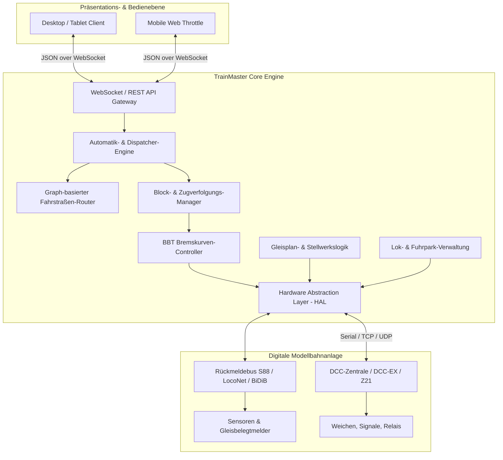
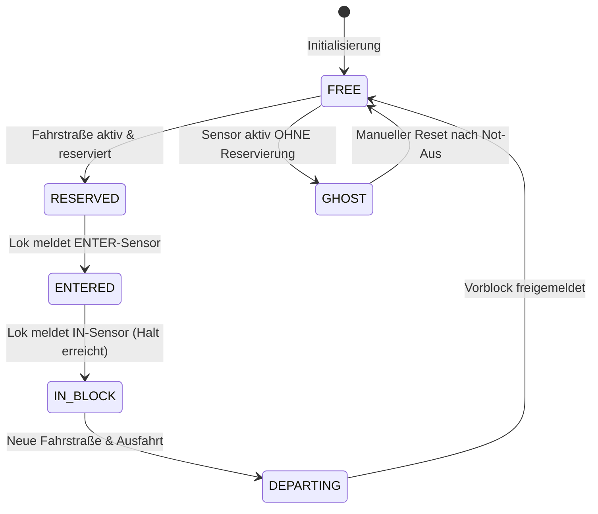

# System- und Software-Spezifikation: TrainMaster
**Version:** 1.0.0  
**Status:** In Vorbereitung / Entwurf  
**System:** Moderne Modellbahn-Steuerung mit automatischer Zugverfolgung, Gleisplan-Editor, BBT und Automatikbetrieb  

---

## Inhaltsverzeichnis
1. [Zielsetzung & Projektübersicht](#1-zielsetzung--projektübersicht)
2. [Gesamtarchitektur & Komponenten](#2-gesamtarchitektur--komponenten)
3. [Hardware-Abstraktion & Protokolle (HAL)](#3-hardware-abstraktion--protokolle-hal)
4. [Gleisplan-Editor & Layout-Engine](#4-gleisplan-editor--layout-engine)
5. [Belegtmeldung, Blockwesen & Zugverfolgung](#5-belegtmeldung-blockwesen--zugverfolgung)
6. [BBT (Block Brake Timer) Spezifikation](#6-bbt-block-brake-timer-spezifikation)
7. [Fahrstraßen-Logik, Stellwerk & Automatik](#7-fahrstraßen-logik-stellwerk--automatik)
8. [Fuhrpark- & Lokomotiv-Verwaltung](#8-fuhrpark---lokomotiv-verwaltung)
9. [Datenmodell & Persistenz](#9-datenmodell--persistenz)
10. [Benutzeroberfläche & Usability (UI/UX)](#10-benutzeroberfläche--usability-uiux)
11. [Nicht-funktionale Anforderungen & Sicherheit](#11-nicht-funktionale-anforderungen--sicherheit)
12. [Roadmap & Meilensteine](#12-roadmap--meilensteine)

---

## 1. Zielsetzung & Projektübersicht

### 1.1 Vision
**TrainMaster** ist eine modulare, plattformunabhängige Steuerungssoftware für digitale Modelleisenbahnen. Sie kombiniert den bewährten Funktionsumfang etablierter Systeme (insbesondere Rocrail) bezüglich **Zugsicherung, Blockbremsung (BBT) und blockbasierter Automatik** mit einem **radikal vereinfachten, intuitiven Bedienkonzept**, moderner Software-Architektur und automatisierter Konfiguration.

### 1.2 Kern-Differenzierungsmerkmale gegenüber Rocrail
* **Moderne, entkoppelte Architektur:** Klare Trennung zwischen zustandsgeführtem, echtzeitfähigem Core-Server und leichtgewichtigen, reaktiven Clients (Desktop, Tablet, Web).
* **Automatisches Routing & Topologie-Erkennung:** Automatische Berechnung gültiger Fahrstraßen durch integrierte Graph-Analyse des Gleisplans (keine manuelle Definition von hunderten Fahrstraßen nötig).
* **Null-Frust-Konfiguration:** Assistenten für Zentralen-Einrichtung, Sensorzuordnung und automatische Lokomotiv-Einmessung.
* **1-Klick-Automatik:** Züge per Drag & Drop auf Blöcke setzen und mit einem Schalter den Zufalls- ("Aquarium") oder Fahrplanbetrieb starten.
* **Visuelle Diagnostik:** Live-Darstellung von Blockzuständen, Weichenverriegelungen und Fehlern direkt im Gleisplan statt in kryptischen Server-Logs.

---

## 2. Gesamtarchitektur & Komponenten



### 2.1 Schichtenmodell
1. **Präsentationsschicht (Client):** Vektorbasiertes Rendering des Gleisplans, Handregler, Monitoring, Dialoge. Kommuniziert asynchron via WebSocket.
2. **Core Engine (Server):**
   * **State Machine:** Single-Source-of-Truth für alle Block-, Zug-, Weichen- und Sensorzustände.
   * **Dispatcher:** Überwacht Reservierungen, Taktfahrpläne und Abfahrtsentscheidungen.
   * **BBT-Controller:** Hochpräzise Zeit- und Fahrstufenregelung beim Heranbremsen an Haltepunkte.
   * **Event-Bus:** Publish/Subscribe-System für hardwarenahe und logische Ereignisse.
3. **Hardware Abstraction Layer (HAL):** Vereinheitlichte Treiberschnittstelle zur Abstraktion unterschiedlicher Zentralenprotokolle.

---

## 3. Hardware-Abstraktion & Protokolle (HAL)

### 3.1 Schnittstellen-Definition
Alle Zentralen implementieren ein einheitliches Interface:
```typescript
interface ICommandStation {
  connect(): Promise<boolean>;
  disconnect(): Promise<void>;
  
  // Lok-Steuerung
  setLocoSpeed(address: number, speedSteps: number, direction: 'FWD' | 'REV'): void;
  setLocoFunction(address: number, functionIndex: number, active: boolean): void;
  emergencyStop(address?: number): void;
  
  // Zubehör
  setTurnout(address: number, state: 'STRAIGHT' | 'DIVERGENT', pulseDurationMs: number): void;
  setSignal(address: number, aspect: SignalAspect): void;
  
  // Events
  onSensorEvent(callback: (sensorAddress: number, state: boolean) => void): void;
  onLocoReport(callback: (address: number, blockAddress: number) => void): void; // RailCom
}
```

### 3.2 Zu unterstützende Protokolle
1. **DCC-EX (CommandStation):**
   * Seriell (USB) und TCP/WiFi.
   * Native Text-Befehle (`<t ...>`, `<a ...>`, `<q>`).
2. **Roco Z21 (LAN / WLAN):**
   * UDP-basiertes Binärprotokoll (Port 21105).
   * Fahrbefehle, Weichen, R-Bus-Rückmeldung, RailCom-Events.
3. **LocoNet (over TCP / USB):**
   * Peered Peer-to-Peer Busprotokoll für Uhlenbrock, Digikeijs, Yamorc.
4. **BiDiB (Bi-Directional Bus):**
   * Hochgeschwindigkeits-Bus mit nativer 100% RailCom-Identifikation und strukturierter Adressierung.
5. **Software-Simulator (Virtuelle Zentrale):**
   * Ermöglicht das Testen des gesamten Gleisplans und der Automatik ohne physische Hardware.
   * Simuliert Zugbeschleunigung, Sensorberührungen und Weichenstellzeiten.

---

## 4. Gleisplan-Editor & Layout-Engine

### 4.1 Koordinaten- & Rastersystem
* **Kachelsystem (Grid):** Diskretes Koordinatensystem $(x, y, z)$, wobei $z$ die Ebene (z. B. 0 = Hauptbahnhof, -1 = Schattenbahnhof) definiert.
* **Element-Orientierung:** Jedes Element besitzt eine Rotation ($0^\circ, 90^\circ, 180^\circ, 270^\circ$).

### 4.2 Elementkatalog
| Kategorie | Elemente | Zustände / Eigenschaften |
| :--- | :--- | :--- |
| **Passiv** | Gerade, Kurve, Kreuzung, Prellbock, Streckentrennung | Dekorative und topologische Verbindung |
| **Weichen** | Weiche Links, Weiche Rechts, Y-Weiche, Dreiwegweiche, DKW (einfach/doppelt) | Gerade, Abzweig, Verriegelt, Störung |
| **Signale** | 2-, 3-, 4-begriffige Hauptsignale, Vorsignale, Sperrsignale | Hp0, Hp1, Hp2, Sh0, Sh1, Vr0, Vr1, Vr2 |
| **Sensoren** | Rückmelder (Stromfühler, Reeds, Lichtschranke, RailCom) | Frei (Inaktiv), Belegt (Aktiv) |
| **Blöcke** | Block-Element (Länge: 2 bis 4 Rasterfelder) | Belegungszustand, Zuggattung, Richtungspfeile, Lok-Label |
| **Zusatz** | Textlabel, Bahnübergang, Entkuppler, Drehscheibe | Interaktiv steuerbar |

### 4.3 Betriebsmodi
* **Konstruktions-Modus (Edit):**
  * Drag & Drop aus Palette oder Schnellplatzierung per Tastenkürzel.
  * Automatische Schienenverbindung bei Aneinanderreihung.
  * Undo/Redo-Stack.
* **Betriebs-Modus (Live / Run):**
  * Interaktives Schalten von Weichen/Signalen per Klick mit Flankenschutz-Prüfung.
  * Dynamische Fahrstraßenausleuchtung:
    * *Grau:* Frei / ungesichert
    * *Gelb:* Reserviert für Fahrstraße
    * *Rot:* Durch Zug belegt
  * Direkte Anzeige der Zug-ID im Block-Element.

---

## 5. Belegtmeldung, Blockwesen & Zugverfolgung

### 5.1 Block-Definition
Ein Block ist ein logisch abgegrenzter Gleisabschnitt, auf dem ein Zug sicher anhalten und warten darf.
* Jeder Block hat zwei Einfahrtseiten: **Seite +** und **Seite -**.
* Blöcke definieren Mindestlängen, Steigungen und zulässige Zuggattungen (z. B. Güterzug, Wendezug, Nahverkehr).

### 5.2 Sensor-Ereignisse im Block
Je nach Einfahrtsrichtung werden den Sensoren logische Rollen zugewiesen:
1. **`ENTER`:** Löst den Bremsvorgang aus. Der Brems-Controller regelt die Fahrstufe ab. Der Folgeblock wird verriegelt.
2. **`PRE2IN` (optional):** Zwischenschritt zur Geschwindigkeitsreduktion bei langen Blöcken.
3. **`IN`:** Der Zug hat den Ziel-Haltepunkt erreicht. Geschwindigkeit wird auf 0 gesetzt. Vorherige Fahrstraße wird aufgelöst.
4. **`OCCUPIED`:** Physische Dauerbelegtmeldung des gesamten Blocks zur Absicherung.



### 5.3 Schutzfunktionen
* **Geisterzug-Erkennung (Ghost Train Detection):** Löst ein Sensor ein `OCCUPIED`- oder `ENTER`-Signal aus, ohne dass eine Fahrstraße diesen Block für einen erwarteten Zug reserviert hat, wird sofort ein **systemweiter Nothalt** ausgelöst.
* **Überlängen-Schutz:** Ein Zug kann keinen Block anfahren, dessen konfigurierte Nutzlänge kürzer ist als die Gesamtzuglänge (Lok + Wagen).

---

## 6. BBT (Block Brake Timer) Spezifikation

BBT ermöglicht ein vorbildgerechtes, gleichmäßiges Abbremsen eines Zuges von Streckengeschwindigkeit bis zum exakten Halt am `IN`-Punkt – unabhängig von Decoder-internen Bremsverzögerungen.

### 6.1 Mathematisches Modell
Gegeben:
* $V_{\text{start}}$: Fahrstufe bei Block-Einfahrt ($ENTER$)
* $V_{\text{min}}$: Ziel-Kriechfahrstufe vor dem Halt (z. B. Stufe 1 bis 10)
* $\Delta V = V_{\text{start}} - V_{\text{min}}$: Anzahl zu reduzierender Fahrstufen
* $T_{\text{ziel}}$: Gewünschte Gesamtdauer der Bremsung (Default: empirisch oder Soll-Zeit)
* $N_{\text{steps}}$: Anzahl der diskreten Drosselungsschritte (üblicherweise $N_{\text{steps}} = \Delta V$)
* $\Delta t = \frac{T_{\text{ziel}}}{N_{\text{steps}}}$: Zeitintervall pro Fahrstufenreduktion

### 6.2 Der adaptive Lernalgorithmus (Self-Learning BBT)
Jeder Durchlauf in einem Block erzeugt ein Messintervall:
* $t_{\text{ENTER}}$: Zeitstempel beim Auslösen des $ENTER$-Sensors.
* $t_{\text{Kriech}}$: Zeitstempel, an dem $V_{\text{min}}$ erreicht wurde.
* $t_{\text{IN}}$: Zeitstempel beim Berühren des $IN$-Sensors.
* $T_{\text{Kriech\_ist}} = t_{\text{IN}} - t_{\text{Kriech}}$: Tatsächliche Dauer, die der Zug im Kriechgang verbracht hat.

**Bewertung:**
1. **Idealzustand:** Der Zug kriecht genau $T_{\text{Kriech\_soll}}$ (z. B. $1.0\text{ s} \pm 0.3\text{ s}$) vor dem $IN$-Sensor.
2. **Zu früh abgebremst ($T_{\text{Kriech\_ist}} > T_{\text{Kriech\_soll}} + \epsilon$):**
   * Der Zug schleicht zu lange.
   * Korrektur: Die Schrittdauer $\Delta t$ wird für den nächsten Durchlauf um den Korrekturfaktor $\alpha$ vergrößert:
     $$\Delta t_{\text{neu}} = \Delta t_{\text{alt}} + \alpha \cdot \frac{T_{\text{Kriech\_ist}} - T_{\text{Kriech\_soll}}}{N_{\text{steps}}}$$
3. **Zu spät / Zu schnell am IN-Sensor ($V(t_{\text{IN}}) > V_{\text{min}}$):**
   * Der Zug hat den Ziel-Haltepunkt erreicht, bevor die Bremsrampe beendet war (Gefahr des Überfahrens).
   * Sofort-Aktion: $V$ wird bei $IN$ hart auf 0 gesetzt.
   * Korrektur: Schrittdauer $\Delta t$ wird drastisch verkürzt.

### 6.3 Datenhaltung der BBT-Matrix
Die Parameter werden in einer Matrix gespeichert:
$$\text{Key} = (\text{Lok-ID}, \text{Block-ID}, \text{Einfahrtseite [+/-]})$$
* Gespeicherte Attribute:
  * `steps`: Anzahl Bremsstufen
  * `interval_ms`: Intervallzeit pro Schritt in Millisekunden
  * `v_start`: Ausgangsgeschwindigkeit
  * `v_min`: Kriechgeschwindigkeit
  * `is_locked`: Sperre gegen automatisches Überschreiben nach erfolgreicher Einmessung.

---

## 7. Fahrstraßen-Logik, Stellwerk & Automatik

### 7.1 Automatischer Fahrstraßen-Generator (Auto-Router)
Das System modelliert das Gleisnetz als gerichteten Graphen $G = (V, E)$:
* **Knoten $V$:** Block-Schnittstellen (`BlockA_+`, `BlockA_-`) und Weichenpole (Stamm, Abzweig, Gerade).
* **Kanten $E$:** Gleissegmente zwischen Weichen und Blöcken.
* **Algorithmus:** 
  * Modifizierte Breitensuche (BFS) oder Dijkstra zur Ermittlung aller kollisionsfreien Wege von `Block X (Seite +/-)` zu `Block Y (Seite +/-)`.
  * Generiert automatisch die benötigten Weichenstellungen (`TurnoutCommands`) und Signalbegriffe für jede gefundene Fahrstraße.

### 7.2 Zugsicherung & Verriegelung (Interlocking)
Bevor ein Zug starten darf, führt der Dispatcher eine atomare Reservierungsprüfung durch:
1. **Freiprüfung:** Zielblock muss den Zustand `FREE` besitzen und die Zuglänge unterstützen.
2. **Fahrstraßen-Reservierung:** Alle Weichen und Kreuzungen im Pfad werden für andere Fahrten verriegelt (`LOCKED`).
3. **Flankenschutz:** Flankenschutz-Weichen auf abweisende Stellung schalten.
4. **Schaltsequenz:** Weichen stellen $\rightarrow$ Stellungsrückmeldung abwarten $\rightarrow$ Signale auf Fahrt (`Hp1` / `Hp2`).

### 7.3 Betriebsmodi der Automatik
1. **Click & Drive (Halbautomatik):**
   * Anwender klickt auf Startblock $\rightarrow$ klickt auf Zielblock.
   * System sucht kürzeste freie Fahrstraße, stellt Weichen, fährt Zug ab und sichert den Zielhalt.
2. **Aquarium-Modus (Zufallsautomatik):**
   * Für jede Lok im Stillstand mit aktiver Automatik:
     * Suche nach allen erreichbaren, freien Blöcken mit passenden Berechtigungen.
     * Zufällige oder prioritätsbasierte Auswahl eines Ziels.
     * Start nach einstellbarer Mindest-Wartezeit (Simulation von Fahrgastwechsel).
3. **Fahrplan-Modus (Schedules):**
   * Geordnete Liste von Blöcken mit optionalen Haltezeiten, Wartebedingungen und Abfahrtszeiten (virtuelle Modellzeit).
4. **Pendelzug-Steuerung (Push-Pull):**
   * Züge mit dem Attribut `isCommuter = true` wechseln nach Ablauf der Haltezeit im Zielblock automatisch die logische Fahrtrichtung und nutzen die Gegen-Fahrstraße.

---

## 8. Fuhrpark- & Lokomotiv-Verwaltung

### 8.1 Datenstruktur Lokomotive
* **Identifikation:** Name, Baureihe, Decoder-Adresse (DCC kurz/lang), Protokoll (DCC14, DCC28, DCC128, MFX/M4).
* **Geschwindigkeitsprofil:**
  * $V_{\text{min}}$ (Rangieren / Kriechgang): z. B. 15 km/h (Fahrstufe 10)
  * $V_{\text{mid}}$ (Abzweig / Langsamfahrt): z. B. 40 km/h (Fahrstufe 50)
  * $V_{\text{max}}$ (Reisegeschwindigkeit): z. B. 120 km/h (Fahrstufe 100)
* **Zugeigenschaften:**
  * Gesamtlänge in cm (für Blockprüfung).
  * Zuggattung: `ICE`, `PERSONENZUG`, `GUETERZUG`, `RANGIER`.
  * Wendezug-Fähigkeit (`commuterTrain`: boolean).
* **Funktionsbelegung (F0–F31):**
  * Typ: Permanent (Schalter), Moment (Taster), Timer.
  * Symbol/Icon: Spitzenlicht, Sound, Hupe/Pfeife, Kupplung, Rauch, Telex etc.

---

## 9. Datenmodell & Persistenz

Alle Konfigurationsdaten werden im offenen JSON-Format gespeichert (Versioniert).

### 9.1 Exemplarisches Datenbankschema (Auszug)
```json
{
  "version": "1.0.0",
  "project": {
    "name": "Hauptanlage_Spur_H0",
    "scale": "H0",
    "gridSize": { "width": 80, "height": 40, "layers": 2 }
  },
  "commandStations": [
    {
      "id": "cs_dcc_ex",
      "type": "DCC_EX",
      "connection": { "interface": "SERIAL", "port": "COM3", "baudrate": 115200 }
    }
  ],
  "locomotives": [
    {
      "id": "loco_br_218",
      "name": "DB BR 218",
      "dccAddress": 218,
      "speedProfile": { "vMin": 8, "vMid": 45, "vMax": 105 },
      "lengthCm": 19.5,
      "trainType": "DIESEL"
    }
  ],
  "blocks": [
    {
      "id": "block_bf_gleis_1",
      "name": "Bahnhof Gleis 1",
      "lengthCm": 180,
      "sensors": {
        "plus": { "enter": "sensor_10", "in": "sensor_11" },
        "minus": { "enter": "sensor_12", "in": "sensor_10" }
      }
    }
  ],
  "bbtEntries": [
    {
      "locoId": "loco_br_218",
      "blockId": "block_bf_gleis_1",
      "direction": "+",
      "steps": 60,
      "intervalMs": 85,
      "vStart": 80,
      "vMin": 8,
      "locked": false
    }
  ]
}
```

---

## 10. Benutzeroberfläche & Usability (UI/UX)

### 10.1 UI-Leitlinien
* **Gleisplan im Zentrum:** Übersichtliches SpDrS60- oder modernes Vektor-Design mit stufenlosem Zoom und Pan.
* **Drag & Drop Lok-Zuweisung:** Lokomotiven werden aus der Roster-Seitenleiste direkt auf den Startblock gezogen.
* **HUD & Mini-Throttle:** Schwebendes Handregler-Panel für die gerade ausgewählte Lokomotive.
* **Diagnose-Overlay:**
  * Jederzeitige Transparenz: Ein Klick auf einen wartenden Zug zeigt einen Tooltip: *"Wartet auf Block 4: Fahrstraße blockiert durch ICE 3"*.

---

## 11. Nicht-funktionale Anforderungen & Sicherheit

1. **Reaktionszeit & Latenz:**
   * Sensor-Ereignis zu Fahrbefehl-Verarbeitung: $< 50\text{ ms}$.
   * Not-Halt-Latenz (UI-Klick oder Tastendruck [Leertaste]): $< 20\text{ ms}$ bis zum Absenden an die Zentrale.
2. **Eigensicherheit (Fail-Safe):**
   * Bei Verbindungsabbruch zwischen Client und Core: Core stoppt Züge nach einstellbarem Timeout (Heartbeat-Überwachung).
   * Bei Verbindungsabbruch zur Zentrale: Sofortiger interner Stopp.
3. **Plattformunabhängigkeit:**
   * Lauffähig unter Windows 10/11, Linux (inkl. Raspberry Pi OS 64-bit), macOS.

---

## 12. Roadmap & Meilensteine

### Meilenstein 1: Minimal Viable Control (MVC)
- [ ] Implementierung der Hardware-Abstraktion (DCC-EX & Virtueller Simulator).
- [ ] Lokomotiven-Verwaltung & einfacher Handregler (Fahren, Richtung, Licht).
- [ ] Serieller Monitor & Logging.

### Meilenstein 2: Gleisplan & Stellwerk
- [ ] Rasterbasierter 2D-Gleisplaneditor (Schienen, Weichen, Signale).
- [ ] Interaktives Schalten von Weichen über DCC-Zubehöradressen.
- [ ] Speichern und Laden des Plans als JSON.

### Meilenstein 3: Sensoren & Blockwesen
- [ ] Anbindung von Rückmeldern (S88 / DCC-EX Inputs).
- [ ] Blocklogik mit `ENTER`- und `IN`-Zustandsautomat.
- [ ] Geisterzug-Überwachung.

### Meilenstein 4: BBT (Intelligentes Bremsen)
- [ ] Timer-gesteuertes Abbremsen der Lok zwischen `ENTER` und `IN`.
- [ ] Implementierung des adaptiven Lernzyklus.
- [ ] Konfigurationsdialog & BBT-Tabelle.

### Meilenstein 5: Automatik & Vollversion
- [ ] Graph-basierter Auto-Router für automatische Fahrstraßen.
- [ ] Click & Drive (Zielauswahl per Klick).
- [ ] Aquarium-Modus (Zufallsfahrten) & Pendelzug-Steuerung.
- [ ] Release TrainMaster v1.0.
