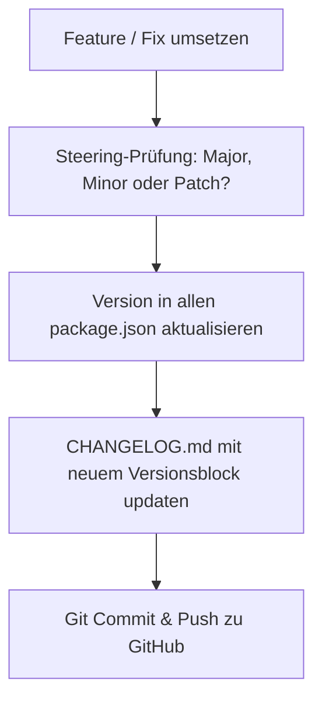

# 🧭 TrainMaster Versioning & Release Steering Rule

Dieses Steering-Dokument ist die verbindliche Richtlinie für alle Code-Änderungen, Features und Releases im TrainMaster-Projekt. Es definiert das Verfahren zur Entscheidung der Versionsnummerierung nach dem Semantic Versioning Standard (SemVer 2.0.0) und die fortlaufende Pflege des `CHANGELOG.md`.

---

## 🎯 1. Die 3 Versionsebenen

Die Versionsnummer folgt dem Schema: **`MAJOR.MINOR.PATCH`** (z. B. `1.1.0`)

### 🔴 1. Major Version (`X.0.0`) – Fundamentale / Breaking Changes
Wann wird die Major-Version erhöht?
- **Inkompatible API- oder Protokolländerungen**: Wenn WebSocket-Nachrichtentypen, WIO/UDP-Paketformate oder Steuerbefehle so geändert werden, dass alte Clients/Nodes nicht mehr kompatibel sind.
- **Datenbank- & Layout-Schema-Umbrüche**: Wenn das JSON-Format von `layout.json` grundlegend geändert wird und alte Gleispläne eine Migrationsroutine erfordern.
- **Architektur-Wechsel**: Grundlegend neuer Unterbau (z. B. Wechsel des Server-Frameworks, Ablösung von Kern-Engines).
- **Entfernen von Features**: Löschung von zuvor unterstützen Hardware-Protokollen oder Hauptfunktionen.

---

### 🟡 2. Sub Version / Minor (`1.X.0`) – Neue Features & funktionale Erweiterungen
Wann wird die Sub-Version erhöht?
- **Neue Features & Systemfähigkeiten**:
  - Hinzufügen des Zweisprachigkeits-Systems (i18n Deutsch/Englisch).
  - Neue Fahrstraßen-Logiken oder Automatik-Modi.
  - Neuer Hardware-Treiber (z. B. LocoNet, BiDiB, MQTT).
  - Neues UI-Modul oder neuer Haupt-Tab (z. B. Fahrplan-Modul, Sound-Modul).
  - Unterstützung für neue Signal-Typen oder Weichen-Arten.
- **Abwärtskompatible API-Erweiterungen**: Neue WebSocket-Nachrichten oder REST-Endpunkte, ohne bestehende zu brechen.
- **Erweiterte Firmware-Funktionen**: Neue Sensor- oder Servo-Funktionen in der ESP32-Firmware.

---

### 🟢 3. Sub-Sub Version / Patch (`1.0.X`) – Bugfixes, Refinements & Optimierungen
Wann wird die Sub-Sub-Version erhöht?
- **Fehlerbehebungen (Bugfixes)**:
  - Z-Order / Layering-Korrekturen (z. B. Blöcke immer über Gleisen).
  - Bereinigung von SVG-Grafikfehlern oder Drehungs-Anzeigefehlern.
  - Behebung von Verbindungsabbrüchen oder Reconnect-Timern.
- **UI- & CSS-Polishing**:
  - Touchscreen-Tweaks, vergrößerte Slider-Knäufe, verbesserte Paddings.
  - Kontrastverbesserungen und Theme-Anpassungen.
- **Performance & Stabilität**:
  - Schnellere Rendering-Loops, Reduktion von DOM-Reflows.
  - Typisierungs-Korrekturen in TypeScript.
- **Dokumentations- & Übersetzungs-Updates**:
  - Nachpflegen von Texten, Korrekturen in Anleitungen oder Übersetzungs-Dateien.

---

## 📋 2. Workflow bei jedem Feature / jeder Änderung

Bei **jeder** Umsetzung eines Tasks oder Features muss der Agent / Entwickler folgende 5 Schritte durchführen:

1. **Steering-Entscheidung treffen**:
   - Prüfen: Handelt es sich um Breaking Change (Major), neues Feature (Minor) oder Bugfix/Polishing (Patch)?
   - Die Begründung kurz im Antworttext oder Commit erläutern.
2. **Versionsnummern synchronisieren**:
   - Root `package.json`
   - `client/package.json`
   - `server/package.json`
   - `client/src/index.html` (Versionstag im Header)
3. **`CHANGELOG.md` aktualisieren**:
   - Unter der neuen Version `[X.Y.Z] - YYYY-MM-DD` eintragen.
   - Unterteilung in `Added`, `Changed`, `Fixed`.
4. **Build-Prüfung**:
   - `npm run build` im Client und Server ausführen.
5. **Git Commit & Push**:
   - Strukturierte Commit-Message nach Conventional Commits:
     - `feat: ...` für Minor
     - `fix: ...` für Patch
     - `feat!: ...` oder `BREAKING CHANGE: ...` für Major
   - Automatischer Push auf `origin main`.
