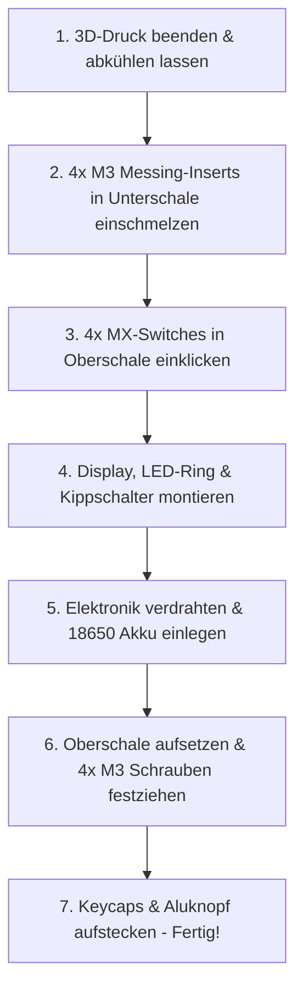

# 🖨️ 3D-Druck & Gehäuse-Leitfaden: TrainMaster ThrottleOne

> **Du musst kein CAD können!**  
> Alle 3D-Modelle für das Gehäuse und die Tastenkappen sind bereits fertig konstruiert, mit exakten FDM-Drucktoleranzen berechnet und liegen druckfertig als **STL-Dateien** im Ordner [`hardware/enclosure/stl/`](file:///c:/Users/etswr/Downloads/TrainMaster/hardware/enclosure/stl/) für dich bereit.

---

## 📂 1. Übersicht der druckfertigen Dateien

| Datei | Bauteil | Empfohlenes Material | Farbe | Druckzeit (Bambu A1/P1/X1) |
|---|---|---|---|:---:|
| [`throttle_top.stl`](file:///c:/Users/etswr/Downloads/TrainMaster/hardware/enclosure/stl/throttle_top.stl) | **Oberschale** (Front mit Ausschnitten für Display, Drehknopf, Halo-Ring, Kippschalter & 4x MX-Switches) | PLA+ oder PETG | Schwarz / Anthrazit | ca. 1h 20min |
| [`throttle_bottom.stl`](file:///c:/Users/etswr/Downloads/TrainMaster/hardware/enclosure/stl/throttle_bottom.stl) | **Unterschale** (Rückseite mit Akkufach für 18650, USB-C Ladeschacht, Ein/Aus-Schalter & M3 Gewindedomen) | PLA+ oder PETG | Schwarz / Anthrazit | ca. 1h 10min |
| [`keycap_stop.stl`](file:///c:/Users/etswr/Downloads/TrainMaster/hardware/enclosure/stl/keycap_stop.stl) | **Nothalt-Tastenkappe** (Großer taktiler Pilzkopf mit Cherry-MX Kreuzaufnahme) | PLA oder PETG | **Rot** (DB-Verkehrsrot) | ca. 12 min |
| [`keycap_function.stl`](file:///c:/Users/etswr/Downloads/TrainMaster/hardware/enclosure/stl/keycap_function.stl) | **Funktionstaste (4x drucken)** (Ergonomische Mulde für Daumenbedienung: F0, F1, F2, Menü) | PLA oder PETG | Grau / Weiß / Schwarz | ca. 20 min (für alle 4) |

> 📁 **Parametrische CAD-Quelldatei:**  
> Für Entwickler oder spätere Modifikationen liegt auch die vollständige OpenSCAD-Datei [`TrainMaster_ThrottleOne.scad`](file:///c:/Users/etswr/Downloads/TrainMaster/hardware/enclosure/TrainMaster_ThrottleOne.scad) bei.

---

## 🎯 2. Angewendete FDM-Drucktoleranzen (Nach Industriestandard)

Alle Aussparungen und Verbindungen wurden exakt nach den FDM-Passungsrichtlinien für 0.4mm Düsen konstruiert:

| Bauteil / Fügestelle | Reales Bauteilmaß | Gehäuse-Ausschnitt | Passungsart & Toleranz | Ergebnis im Druck |
|---|---|---|---|---|
| **MX-Tastatur-Switches** | 14.00 × 14.00 mm | **14.10 × 14.10 mm** (Wandstärke: 1.50 mm) | **Snug Fit (+0.10 mm)** | Die Schalter rasten mit ihren seitlichen Kunststoffclips satt und ohne Spiel mit einem spürbaren "Klick" ein. Kein Kleben nötig! |
| **EC11 Drehencoder-Halterung** | 7.0 mm M7 Gewindekragen | **7.20 mm Kernbohrung** in massivem 26mm Mittelsteg | **Sliding Fit (+0.20 mm)** | Der Encoder wird von hinten in die Oberschale gesteckt und von vorne mit der beiliegenden M7-Mutter fest verschraubt! Bombenfester Sitz ohne Wackeln. |
| **Status-Halo (Lichtkanal)** | 33.0 mm Aluknopf / 50.0 mm LED-Ring | **34–42 mm Ringschlitz** mit 4 diagonalen Stegen + **50.4 mm Tasche** innen | **Halo-Kanal** | Die 4 schmalen 3mm-Stege halten den Encodersockel unzerstörbar stabil. Der 33mm Aluknopf verdeckt den Sockel und die M7-Mutter komplett, sodass der Lichtring als perfekter Halo erstrahlt. |
| **MTS-103 Kippschalter** | 6.00 mm M6 Gewinde | **6.35 mm Bohrung** | **Sliding Fit (+0.35 mm)** | Der Schalter lässt sich ohne Feilen von hinten durchschieben; die Kontermutter klemmt ihn fest. |
| **1.54" IPS Display (ST7789)** | 27.7 × 27.7 mm Display / 31.5 × 43.5 mm PCB | **28.5 × 28.5 mm Fenster** + **32.5 × 44.0 mm Tasche** | **Clearance Fit (+0.50 mm)** | Kein Druck auf das empfindliche Glas; sitzt bündig in der inneren Passstufe. |
| **M3 Messing-Einschmelzgewinde** | 4.60 mm Außendurchmesser | **4.20 mm Kernloch** in 8.0 mm Stützdom | **Interference / Melt Fit (-0.40 mm)** | Das heiße Messing schmilzt formschlüssig in den Kunststoff. Maximale Zugfestigkeit, leiert nie aus. |
| **Gehäusefuge (Nut & Feder)** | 1.20 mm Wandversatz | **Umlaufend +0.25 mm Spalt** | **Transition Fit (+0.25 mm)** | Ober- und Unterschale schließen bündig ab, dichten gegen Staub ab und klemmen nicht. |
| **USB-C Port (TP4056)** | 8.9 × 3.2 mm Buchse | **11.0 × 6.0 mm** mit Fase | **Clearance Fit (+1.00 mm)** | Auch dickere Ladekabel-Stecker rasten vollständig ein. |
| **MX-Keycap Kreuzaufnahme** | 4.0 × 4.0 mm Kreuz (1.15 mm Steg) | **1.35 mm Kreuzschlitze** | **Snug Fit (+0.15 mm)** | Kappen lassen sich von Hand aufdrücken, sitzen fest und wackeln nicht. |

---

## 📐 2.1 Durchdachte Innenraum-Aufteilung (Kein Platzmangel!)

Die Gesamt-Gehäusehöhe beträgt **34.0 mm** (Oberschale: 16 mm, Unterschale: 18 mm, Innen-Hohlraum: **29.2 mm**). Alle Komponenten sind in getrennten Zonen untergebracht:

```text
┌────────────────────────────────────────────────────────┐
│ OBERE ZONE (Display & ESP32-S3):                       │
│ - Oben: 1.54" IPS Display (flach, nur 3mm dick)        │
│ - Unten: ESP32-S3 DevKit auf integrierten Standoffs     │
│   ==> Über 20 mm Freiraum dazwischen für Kabel!        │
├────────────────────────────────────────────────────────┤
│ MITTLERE ZONE (Fahrregler & Richtung):                 │
│ - Oben: EC11 Drehencoder & MTS-103 Kippschalter        │
│ - Unten: Komplett freier Verkabelungsraum!             │
├────────────────────────────────────────────────────────┤
│ UNTERE ZONE (Bedienung & Akku):                        │
│ - Unten: 18650 Akkuhalter mittig in Führungsschienen   │
│ - Oben: 4x MX-Switches links (X=-20mm) & rechts (+20mm)│
│   ==> 26 mm breiter freier Mittelkorridor über dem Akku!│
├────────────────────────────────────────────────────────┤
│ BODENKANTE:                                            │
│ - TP4056 USB-C Ladebuchse & Ein/Aus-Schiebeschalter    │
└────────────────────────────────────────────────────────┘
```

---

## ⚙️ 3. Empfohlene Einstellungen in Bambu Studio

Öffne Bambu Studio und ziehe die `.stl` Dateien einfach per Drag & Drop auf die Druckplatte:

```text
┌────────────────────────────────────────────────────────┐
│  Bambu Studio Druck-Profil                             │
├────────────────────────────────────────────────────────┤
│  Drucker:        Bambu Lab A1 / P1S / X1C / A1 mini     │
│  Düse:           0.4 mm Stainless / Hardened Steel     │
│  Druckplatte:    Textured PEI Plate (gibt edles Finish)│
│  Schichthöhe:    0.20 mm Standard                      │
│  Wandlinien:     4 bis 5 (für maximale Stabilität)     │
│  Infill:         20% Gyroid (sehr verwindungssteif)    │
│  Stützstruktur:  Keine nötig! (Beide Schalen liegen     │
│                  flach auf der großen Trennebene)      │
│  Material:       PETG oder PLA Basic / Matte           │
└────────────────────────────────────────────────────────┘
```

> [!TIP]
> **Strukturierte PEI-Platte verwenden:**  
> Wenn du auf einer strukturierten PEI-Platte druckst, erhält die Gehäusefront eine leicht mattschwarze, fein gekörnte Oberfläche, die wie professioneller Spritzguss aussieht und absolut unempfindlich gegen Fingerabdrücke ist!

---

## 🔨 4. Montage-Anleitung (In 5 Minuten zusammengesteckt)



### Schritt 1: M3 Einschmelzgewinde einsetzen
1. Stelle deinen Lötkolben auf **ca. 210–230 °C** (bei PLA) bzw. **240 °C** (bei PETG).
2. Setze die M3-Messingmutter gerade auf eines der 4 Ecklöcher in der Unterschale.
3. Drücke die Lötkolbenspitze mit leichtem Druck auf die Messingmutter.
4. Nach 2–3 Sekunden erwärmt sich das Messing und sinkt butterweich bündig in den Kunststoffdom ein.
5. Lötkolben sofort senkrecht nach oben abziehen und 15 Sekunden abkühlen lassen.

### Schritt 2: Tastatur-Schalter einklicken
- Nimm die 4 Cherry MX / Gateron Taster und drücke sie von oben in die 14x14 mm Ausschnitte der Oberschale.
- Durch die 1.5 mm Kantenstärke machen die Kunststoffnasen hörbar *"Klick"* – die Switches sitzen bombenfest!

### Schritt 3: Oberschalen-Komponenten
- **WS2812B LED-Ring**: Von unten in die 50.4 mm runde Innentasche legen (kann mit einem winzigen Punkt Heißkleber oder Doppelklebeband gesichert werden).
- **1.54" IPS Display**: In die rechteckige Innentasche einlegen.
- **MTS-103 Kippschalter**: Durch das 6.35 mm Loch schieben, Unterlegscheibe und Mutter von oben aufschrauben und mit einer Zange/einem Schlüssel handfest ziehen.
- **Drehimpulsgeber (EC11)**: Hinter dem LED-Ring positionieren.

### Schritt 4: Zusammenschrauben
- 18650 Akkuhalter und TP4056 Ladeplatine in die Führungen der Unterschale legen.
- Oberschale aufsetzen (die Nut & Feder Passung führt beide Hälften exakt zusammen).
- 4x M3 × 8 mm oder M3 × 10 mm Innensechskantschrauben (schwarz) von oben eindrehen – fertig!
