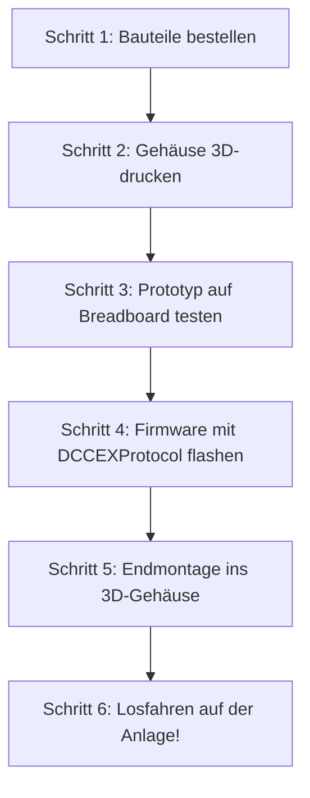

# 📋 Stückliste & Hardware-Plan: TrainMaster ThrottleOne

> **Vollständige Einkaufsliste (BOM), Pinbelegung und Hardware-Schaltplan für den Bau des TrainMaster ESP32-S3 Handreglers.**

---

## 🛒 1. Bauteilliste (Bill of Materials - BOM)

### 🔹 Hauptkomponenten

| Nr. | Komponente | Spezifikation / Modell | Empfohlene Bezugsquelle | Ca. Preis |
|:---:|---|---|---|:---:|
| **1** | **Mikrocontroller-Board** | **ESP32-S3 DevKitC-1** (N16R8 oder N8R8) mit USB-C, Dual-Core 240 MHz, 8MB/16MB Flash, 8MB PSRAM *(Alternativ: Seeed Studio XIAO ESP32-S3 für ultra-kompakte Bauweise)* | AliExpress / Amazon / Berrybase | 4,50 € |
| **2** | **Display-Modul** | **1.54 Zoll IPS TFT (ST7789)**, 240x240 Pixel, SPI-Schnittstelle, 3.3V *(7 oder 8 Pins: GND, VCC, SCL, SDA, RES, DC, CS, BLK)* | AliExpress / Amazon | 4,00 € |
| **3** | **Drehimpulsgeber (Encoder)** | **Bourns PEC11R-4220F-S0024** oder **Alps EC11** mit integriertem Tastklick, 24 Impulse/Umdrehung mit fühlbaren Rasten, 6mm Achse | Reichelt / Mouser / AliExpress | 1,80 € |
| **4** | **Drehregler-Knopf** | Aluminium-Knopf gerändelt, **ø 30–32 mm**, Höhe 12–15 mm, 6mm Achsaufnahme mit Madenschraube oder Fingermulde | Amazon / AliExpress | 2,00 € |
| **5** | **Nothalt-Taster** | 12x12 mm taktiler Taster mit **roter Tastenkappe (ø 10–12 mm)** oder APEM/E-Switch Tastschalter | Reichelt / AliExpress | 0,80 € |
| **6** | **Funktionstasten (4x)** | 6x6 mm Kurzhubtaster (Bauhöhe 7–9 mm) oder Silikon-Mikrotaster + bedruckbare/farbige Tastenkappen (F0, F1, F2, Shift) | AliExpress / Reichelt | 1,20 € |
| **7** | **Richtungsschalter** | Miniatur-Schiebeschalter (SPDT 1x UM) oder Wipptaster Vorwärts/Rückwärts | Reichelt / Conrad | 0,60 € |

---

### 🔋 Stromversorgung & Akkumanagement

| Nr. | Komponente | Spezifikation / Modell | Details | Ca. Preis |
|:---:|---|---|---|:---:|
| **8** | **Akku** | **18650 Li-Ion Zelle (z. B. Samsung INR18650-35E oder LG MJ1)**, 3.7V, 3000–3500 mAh *(Alternativ: Flach-LiPo 2000 mAh)* | Nkon / Reichelt / Amazon | 4,50 € |
| **9** | **18650 Batteriehalter** | 1x 18650 SMD- oder Durchsteck-Batteriefach mit Federkontakt | AliExpress / Reichelt | 0,60 € |
| **10** | **Ladeelektronik (BMS)** | **TP4056 USB-C Lademodul mit Schutzschaltung** (DW01A + FS8205A Überlade- & Tiefentladeschutz, 1A Ladestrom) *(Alternativ: IP5306 All-in-One Power-Management IC)* | AliExpress / Amazon | 0,80 € |
| **11** | **Ein/Aus-Schiebeschalter** | SS12D00 Miniatur-Schiebeschalter (3 Pins, 1x UM) für Hauptstromunterbrechung | AliExpress | 0,30 € |
| **12** | **Akkuspannungs-Messung** | 2x Präzisions-Widerstand **100 kΩ (1%)** für 1:2 Spannungsteiler an ESP32 ADC | Reichelt / Bastelkiste | 0,10 € |

---

### 📳 Haptik, Licht & Kleinteile

| Nr. | Komponente | Spezifikation / Modell | Details | Ca. Preis |
|:---:|---|---|---|:---:|
| **13** | **Vibrationsmotor** | **1027 Münz-Vibrationsmotor (Coin ERM)**, 3V, ø 10mm, selbstklebend | AliExpress / Amazon | 0,60 € |
| **14** | **Motortreiber** | 1x **2N7002** N-Kanal MOSFET (oder NPN Transistor BC547) + 1x Freilaufdiode **1N4148** + 1x 1kΩ Gate-Widerstand | Bastelkiste / Reichelt | 0,30 € |
| **15** | **Status-LED** | 1x **WS2812B (NeoPixel)** RGB-LED (SMD 3535 oder 5mm Modul) für Gleisstrom- und Verbindungsanzeige | AliExpress | 0,30 € |
| **16** | **Schrauben & Inserts** | 4x **M2.5 oder M3 Messing-Einschmelzgewinde** (Heat-Set Inserts, Länge 4–5 mm) + 4x M2.5x8 mm Zylinderkopfschrauben | Amazon / AliExpress | 1,50 € |
| **17** | **Gehäuse-Material** | 100g **PETG oder PLA+ Filament** (Schwarz, Anthrazit oder DB-Verkehrsrot für Nothalt) | 3D-Drucker | ~ 2,00 € |
| **18** | **Trageschlaufe (Lanyard)** | Handgelenkschlaufe mit Schnellverschluss (Absturzsicherung) | Amazon / Vorhanden | 0,50 € |

**Gesamtkosten für 1 Handregler: ca. 24,00 € – 28,00 €**

---

## ⚡ 2. Schaltplan & Pinbelegung (ESP32-S3)

Der **ESP32-S3** bietet 45 frei konfigurierbare GPIOs ohne die alten ADC2/WLAN-Konflikte des Vorgängers:

```text
               ┌──────────────────────────────┐
               │         ESP32-S3             │
               │                              │
[Display CS]  ── GPIO 10             GPIO 1  ── [Encoder Phase A (CLK)]
[Display DC]  ── GPIO 9              GPIO 2  ── [Encoder Phase B (DT)]
[Display RES] ── GPIO 8              GPIO 3  ── [Encoder Taster (SW)]
[Display SCL] ── GPIO 12 (SCK)       GPIO 4  ── [NOTHALT Taster (ROT)]
[Display SDA] ── GPIO 11 (MOSI)      GPIO 5  ── [Taste F0 (Licht)]
[Display BLK] ── GPIO 7 (PWM Hellig) GPIO 6  ── [Taste F1 (Sound)]
               │                     GPIO 13 ── [Taste F2 (Horn/Pfiff)]
[WS2812B LED] ── GPIO 18             GPIO 14 ── [Taste SHIFT / Menü]
[Vibrationsmot]── GPIO 17 (PWM/FET)  GPIO 15 ── [Richtungsschalter Vorwärts]
[Akku ADC]    ── GPIO 21 (Teiler)    GPIO 16 ── [Richtungsschalter Rückwärts]
               │                              │
[USB D-]      ── GPIO 19             GPIO 20 ── [USB D+] (Natives USB-C)
               └──────────────────────────────┘
```

---

## 📐 3. Gehäuse-Maße & 3D-Druck-Konzept

- **Außenmaße**: ca. **142 mm Höhe × 68 mm Breite × 28 mm Tiefe**
- **Gewicht**: ca. 160 g (inkl. 18650-Akku – liegt perfekt ausbalanciert in der Hand)
- **Ergonomische Zonen**:
  1. **Obere Zone (Display & Nothalt)**:
     - Leicht um 8° zum Benutzer geneigtes Displayfenster für optimalen Ablesewinkel.
     - Nothalt-Taste oben links an der Schräge – mit dem linken Zeigefinger sofort erreichbar.
  2. **Mittlere Zone (Fahrregler)**:
     - Drehknopf mittig platziert, von links und rechts mit dem Daumen bequem erreichbar (Rechts- und Linkshänder tauglich).
     - Leuchtender Acrylglas-Ring (Halo) um den Knopf, beleuchtet durch die WS2812B LED.
  3. **Untere Zone (Tastenfeld & Griff)**:
     - 4 gummierte/taktile Tasten im Daumen-Radius.
     - Hinteres Gehäuse tailliert mit 3 Finger-Griffmulden für ermüdungsfreies Halten.

---

## 🛠️ 4. Schritt-für-Schritt Bauanleitung



1. **Schritt 1 (Breadboard-Test)**:
   - ESP32-S3, Display und Drehencoder auf einem Steckbrett verdrahten.
   - Test-Firmware mit der `DCCEXProtocol` Library flashen und Geschwindigkeit einer Lok regeln.
2. **Schritt 2 (3D-Druck)**:
   - Oberschale, Unterschale und Drehknopf mit 0.16 mm Layerhöhe in PETG drucken.
   - Messing-Einschmelzgewinde (Heat-Set Inserts) mit der Lötkolbenspitze (ca. 220°C) vorsichtig in die 4 Gehäusedome einschmelzen.
3. **Schritt 3 (Elektronik-Zusammenbau)**:
   - TP4056 Ladeplatine und Ein/Aus-Schalter mit dem Akkuhalter verdrahten.
   - ESP32 und Taster auf einer Lochraster-Platine (oder der geätzten Custom-Platine) verlöten.
4. **Schritt 4 (Endmontage)**:
   - Display mit 2 Tropfen Heißkleber oder Cliphalter in der Oberschale fixieren.
   - Elektronik einsetzen, 18650 Zelle einlegen und Gehäuse mit den 4 M2.5/M3 Schrauben verschließen.

---

## 🔍 5. Copy & Paste Suchbegriffe für AliExpress

Mit diesen exakten englischen Bezeichnungen findest du bei AliExpress direkt die richtigen Angebote ohne Umwege:

| Bauteil | 📋 Exakter Suchbegriff (Copy & Paste) | Worauf achten? |
|---|---|---|
| **ESP32-S3 Board** | `ESP32-S3 DevKitC-1 N16R8 Type-C` | N16R8 (16MB Flash, 8MB PSRAM) oder N8R8 wählen; Dual Type-C Ports |
| **Display** | `1.54 inch IPS ST7789 SPI 240x240 8pin` | Achte auf 8 Pins (GND, VCC, SCL, SDA, RES, DC, CS, BLK) & 3.3V |
| **Drehencoder** | `EC11 rotary encoder with switch 20mm` | 5 Pins (3 für Encoder, 2 für Taster), D-Achse oder geriffelt |
| **Alu-Knopf** | `30mm aluminium knob 6mm shaft` | Durchmesser 30–32 mm, 6mm Bohrung mit seitlicher Madenschraube |
| **Nothalt-Taster** | `12x12x7.3 tactile switch with round cap red` | 12x12 mm Mikrotaster mit aufsteckbarer runder roter Kappe |
| **F-Tasten (4x)** | `6x6x8 tactile push button switch cap` | 6x6 mm Taster mit Höhe 8–9 mm und farbigen Kappen |
| **Richtungsschalter** | `SS12D00 slide switch 3 pin` | 3 Pins (1x UM Schalter) für Vor/Rück oder Ein/Aus |
| **Ladeplatine (BMS)**| `TP4056 Type-C with protection 5V 1A` | Unbedingt die Version **mit Schutz** (DW01A Chip, 2x ICs auf Board) |
| **18650 Halter** | `18650 battery holder with wires` | 1-Slot Batteriefach mit Anschlussdrähten (rot/schwarz) |
| **Vibrationsmotor** | `1027 coin vibration motor 3V` | 10 mm Durchmesser, 2.7 mm flach, mit Klebepad |
| **Gewindeeinsätze** | `M3 heat set inserts brass M3x4x5` | Für M3 Schrauben, Außendurchmesser ca. 4.6–5 mm, Länge 4–5 mm |
| **Schrauben** | `M3x8 hex socket head cap screws black` | M3 x 8 mm Zylinderkopf-Inbusschrauben (Schwarz oder Edelstahl) |
| **RGB Status-LED** | `WS2812B RGB LED breakout module 5050` | Mini-Platine mit WS2812B (VCC, GND, DIN, DOUT) |
