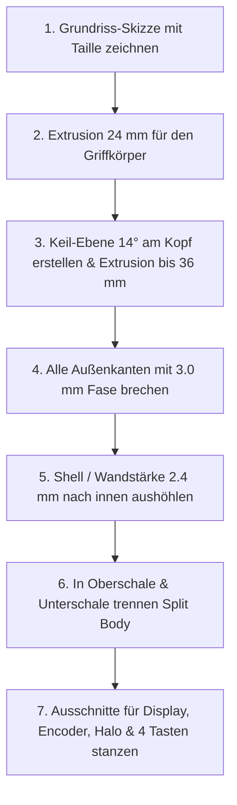

# 📐 Technischer Blueprint & CAD-Konstruktionsplan: TrainMaster ThrottleOne

> **Vollständige Maßzeichnung, Schnittansichten und Konstruktionsanleitung zum exakten Nachbau des Handregler-Designs aus dem Mockup-Rendering.**

---

## 🖼️ Referenz-Design (Das Mockup)


### Charakteristische Merkmale des Designs:
1. **Ergonomischer Keilkopf (Wedge):** Der obere Display-Bereich ist um **14° zum Benutzer geneigt**, sodass das Display im natürlichen Handhaltewinkel perfekt ablesbar ist.
2. **Taillierung (Pinch Grip):** Das Gehäuse verjüngt sich unterhalb des Displays von **74 mm auf 62 mm**, damit Daumen und Zeigefinger das Gerät ermüdungsfrei umgreifen können.
3. **Facettierte Kanten (Chamfers):** Alle Gehäusekanten haben eine **45° Fase (3.0 mm)** anstelle von simplen Rundungen – das gibt den futuristischen Industrie-Look.
4. **Schulter-Nothalt (Emergency Stop):** Der rote STOP-Taster sitzt an der **linken oberen Schräge/Schulter**, sodass der Zeigefinger ihn blind und reflexartig drücken kann.
5. **Zentraler Drehregler mit Halo-Licht:** Ein versenkter ø 33 mm Drehknopf mit gerändeltem Rand, umgeben von einem leuchtenden 1.5 mm Lichtspalt.
6. **Horizontale 4er-Tastenleiste:** Unten sitzt eine ergonomische Reihe von 4 Tasten nebeneinander (`F0 Light`, `F1 Sound`, `F2 Horn`, `SHIFT`).

---

## 📏 1. Maßskizzen (Orthogonale Ansichten)

### 🔹 Ansicht A: Draufsicht (Top View) – Alle Maße in mm

```text
       ┌─────────────── 74.0 mm ───────────────┐
       │   /- - - - - - - - - - - - - - - -\   │
  /────┴──/                                 \──┴────\
 /       /  ┌─────────────────────────────┐  \       \
│ [STOP]│   │    1.54" IPS DISPLAY        │   │       │  <-- Obere Schräge
│  ø16  │   │    Sichtfenster 28.5 x 28.5 │   │       │      (Breite: 74 mm)
 \       \  └─────────────────────────────┘  /       /
  \───────\                                 /───────/
           \---\                       /---/
                \                     /
                 │   TAILLIERUNG     │                   <-- Ergonomische Taille
                 │   (Breite 62 mm)  │                       (Breite: 62 mm)
                 │                   │
                 │     /-------\     │
                 │    /  HALO   \    │
                 │   │   ø36mm   │   │                   <-- Drehregler-Zone
                 │   │  [Knopf]  │   │                       (33mm Knopf in
                 │   │   ø33mm   │   │                        36mm Lichtring)
                 │    \         /    │
                 │     \-------/     │
                 │                   │
                 │   [SPEED-LABEL]   │
                 │                   │
                 │ ┌───┐┌───┐┌───┐┌───┐│
                 │ │ F0││ F1││ F2││SFT││                 <-- Horizontale Tastenreihe
                 │ └───┘└───┘└───┘└───┘│                     (4x nebeneinander)
                 │  13   13   13   13  │
                 \                     /
                  \─── 66.0 mm ───────/                  <-- Fußbereich (Breite: 66 mm)
```

---

### 🔹 Ansicht B: Seitenprofil (Side Wedge View)

```text
                         14° Display-Neigung
                              ▲
                             /
                     /------/ 
                    /      /  <-- Kopfteil: Dicke 36.0 mm
                   /      /       (Schräge bietet innen massig Platz für ESP32!)
                  /      /
          /------/      /
         │             /
         │  GRIFFTEIL └────────────────┐
         │  Dicke: 24.0 mm             │                 <-- Griffbereich flach
         │                             │                     und handlich
         └─────────────────────────────┘
          ◄────── Gesamtlänge: 162.0 mm ──────►
```

---

### 🔹 Ansicht C: Vertikaler Längsschnitt (Innenraum & Komponenten)

```text
┌─────────────────────────────────────────────────────────────┐
│ KOPF-ZONE (Angewinkelt 14°):                                │
│  - Oberschale: 1.54" IPS Display (schräg zur Sichtachse)    │
│  - Gehäuseschulter links: Bohrung für Nothalt-Taster        │
│  - Unterschale Boden: ESP32-S3 DevKitC (flach montiert)     │
│    ==> Vertikaler Freiraum: 26 mm! Keine Kollision!         │
├─────────────────────────────────────────────────────────────┤
│ MITTEL-ZONE (Tailliert):                                    │
│  - Oberschale: EC11 Drehencoder-Sockel (M7 Mutter)          │
│  - Innentasche: WS2812B 12-Bit LED Ring (ø 50 mm)          │
│  - Unten: Freiraum für Kabelbaum & Steckverbinder           │
├─────────────────────────────────────────────────────────────┤
│ GRIFF-ZONE (Untere Hälfte):                                 │
│  - Oberschale: 4x Tastatur-Switches in einer Querreihe       │
│  - Unterschale: 1x 18650 Akkuhalter (längs mittig)          │
│    ==> Akku liegt UNTER der Tastenreihe im Griffschwerpunkt  │
├─────────────────────────────────────────────────────────────┤
│ BODENKANTE:                                                 │
│  - Mittig: USB-C Aussparung (11.0 x 6.0 mm) für TP4056      │
│  - Seitlich: Ein/Aus-Schiebeschalter (SS12D00)              │
│  - Ecke: 3.5 mm Öse für Handschlaufe (Lanyard)              │
└─────────────────────────────────────────────────────────────┘
```

---

## 📊 2. Exakte Koordinaten & CAD-Bohrungsmaße

Alle Koordinaten ausgehend vom **Mittelpunkt des Gehäuses (X = 0, Y = 0)**:

### 1. Außenabmessungen
- **Gesamtlänge:** 162.0 mm (von Y = -81.0 bis Y = +81.0)
- **Breite Kopfbereich:** 74.0 mm
- **Breite Taillenbereich:** 62.0 mm (Taille bei Y = +15.0 bis -10.0 mm)
- **Breite Fußbereich:** 66.0 mm
- **Gesamthöhe Kopf:** 36.0 mm (Wedge-Winkel: 14°)
- **Gesamthöhe Griff:** 24.0 mm
- **Wandstärke (Shell):** 2.4 mm (entspricht 6 Wandlinien bei 0.4mm Nozzle)
- **Außenfasen:** 3.0 mm × 45° an allen vertikalen Ecken; 1.5 mm Fase an der Oberkante.

---

### 2. Ausschnitte in der Oberschale

| Element | Position (X / Y) | Ausschnittsmaß (CAD) | Reales Bauteil & Passung |
|---|---|---|---|
| **1.54" Display Sichtfenster** | X = 0.0, Y = +52.0 (auf 14° Schräge) | **28.5 × 28.5 mm** (Tiefe: durchgehend) | Aktive Fläche: 27.7 × 27.7 mm (+0.8 mm Spiel) |
| **Display Platinentasche** | X = 0.0, Y = +52.0 (Innenseite) | **32.5 × 44.0 mm** (Tiefe: 1.5 mm) | Display PCB: 31.5 × 43.5 mm (+1.0 mm Freiraum) |
| **Nothalt-Taster (Schulter)** | X = -38.0, Y = +52.0 (an linker Fase) | **ø 12.2 mm** oder **ø 16.0 mm** Bohrung | Roter Pilztaster / 12mm Taster oder MX-Switch |
| **Drehencoder Achsbohrung** | X = 0.0, Y = +6.0 mm | **ø 7.20 mm** (Zentraler Sockel ø 24 mm) | EC11 Gewindebuchse M7 (+0.2 mm Sliding Fit) |
| **Halo-Lichtkanal (Ringschlitz)**| X = 0.0, Y = +6.0 mm | **Innen ø 34.0 mm, Außen ø 41.0 mm** | 4 Verbindungsstege à 2.5 mm bei 45°/135°/225°/315° |
| **LED-Ring Tasche (Innenseite)**| X = 0.0, Y = +6.0 mm | **ø 50.4 mm** (Tiefe: 1.8 mm) | WS2812B 12-Bit Ring Platine (ø 50.0 mm) |
| **F0 Taste (Licht)** | X = -21.0, Y = -46.0 mm | **14.10 × 14.10 mm** (Tiefe: 1.5 mm Plate) | Cherry MX Switch (+0.10 mm Snug/Snap Fit) |
| **F1 Taste (Sound)** | X = -7.0, Y = -46.0 mm | **14.10 × 14.10 mm** (Tiefe: 1.5 mm Plate) | Cherry MX Switch (+0.10 mm Snug/Snap Fit) |
| **F2 Taste (Horn)** | X = +7.0, Y = -46.0 mm | **14.10 × 14.10 mm** (Tiefe: 1.5 mm Plate) | Cherry MX Switch (+0.10 mm Snug/Snap Fit) |
| **SHIFT / Menü Taste** | X = +21.0, Y = -46.0 mm | **14.10 × 14.10 mm** (Tiefe: 1.5 mm Plate) | Cherry MX Switch (+0.10 mm Snug/Snap Fit) |

> 💡 **Tipp zu den 4 Tasten:**  
> Die 4 Tasten haben einen Mittenabstand von jeweils **14.0 mm Loch + 4.0 mm Steg = 18.0 mm Raster**. Das ist der perfekte Standard-Abstand für Daumenbedienung!

---

### 3. Aufnahmen in der Unterschale

| Element | Position | CAD-Maß | Funktion |
|---|---|---|---|
| **ESP32-S3 Standoffs (4x)** | X = ±12.5 mm, Y = +38.0 / +68.0 mm | ø 4.5 mm Dom mit **ø 1.8 mm Pin** (Höhe: 3.5 mm) | ESP32 Platine wird einfach auf die 4 Pins gesteckt. |
| **18650 Akkuführung** | X = 0.0, Y = -15.0 bis -75.0 mm | Breite: **22.0 mm**, Länge: **77.0 mm**, Schienenhöhe: 6 mm | Hält den 18650 Batteriehalter exakt in der Mitte. |
| **USB-C Schacht (TP4056)** | X = 0.0, Y = -81.0 mm (Unterkante) | **11.0 × 6.0 mm** mit 1.0 mm Fase | Ermöglicht Einstöpseln aller USB-C Ladekabel. |
| **Schiebeschalter-Slot** | X = -31.0 mm (an linker Taillenseite) | **9.0 × 4.2 mm** Durchbruch | SS12D00 Ein/Aus Schiebeschalter. |
| **M3 Einschmelzgewinde (4x)** | X = ±26.0 mm, Y = ±68.0 mm | **ø 4.20 mm Bohrung**, 6.0 mm tief in ø 8 mm Dom | Für M3x4x5 mm Messing-Gewindeeinsätze. |

---

## 🛠️ 3. Schritt-für-Schritt CAD-Bauplan (z. B. Fusion 360 oder Onshape)

Wenn du das Gehäuse selbst in einem CAD-Programm nachbauen möchtest, folge dieser erprobten Reihenfolge:



### Schritt 1: Grundriss (Skizze auf XY-Ebene)
1. Zeichne ein Rechteck 162 × 74 mm zentriert auf dem Ursprung.
2. Füge zwei symmetrische Kreisbögen an den Seiten ein, um die Taille auf 62 mm einzuziehen.
3. Zeichne an den 4 Ecken 8×8 mm Schrägen (Fasen) ein.
4. Extrudiere diesen Körper um **24.0 mm** nach oben.

### Schritt 2: Der 14° Keilkopf (Display-Neigung)
1. Erstelle eine Skizze auf der Seitenansicht (XZ-Ebene).
2. Zeichne ab Y = +15.0 mm eine Linie mit **14° Steigung** nach oben bis zum Kopfende (Gesamthöhe am Kopfende = 36.0 mm).
3. Verwende `Extrude (Join)` oder `Loft`, um den Keil auf die Oberseite des Kopfbereichs aufzutragen.

### Schritt 3: Facetten & Schale
1. Wähle alle Außenkanten an und wende eine **3.0 mm Fase (Chamfer)** an.
2. Wähle das Werkzeug **Aushöhlen (Shell)** mit einer Wandstärke von **2.4 mm**. (Die Unterseite bleibt vorerst offen).

### Schritt 4: Teilung in Oberschale & Unterschale
1. Erstelle eine Versatzebene bei **Z = 12.0 mm** (parallel zum Druckbett).
2. Nutze das Werkzeug **Körper teilen (Split Body)** entlang dieser Ebene.
3. Du hast nun zwei separate Körper: `Top_Shell` und `Bottom_Shell`.

### Schritt 5: Ausschnitte Oberschale
- **Display:** Auf die 14°-Schräge eine Skizze legen -> 28.5 × 28.5 mm Rechteck -> `Extrude (Cut)`.
- **Nothalt-Schulter:** Auf die linke Kopf-Fase klicken -> ø 12.0 mm Kreis -> `Extrude (Cut)`.
- **Drehknopf & Halo:** Kreis ø 41 mm und Kreis ø 34 mm extrudieren; 4 Stege à 2.5 mm stehen lassen; zentralen Sockel mit 7.2 mm Loch erzeugen.
- **Tastenreihe:** 4 Rechtecke 14.10 × 14.10 mm in einer Reihe nebeneinander ausschneiden.

---

## 💎 4. Was dieses Design so überragend macht

1. **Gewichtsbalance:** Durch den schweren 18650-Akku im unteren Griff und den massiven Aluknopf in der Mitte liegt der Schwerpunkt genau in deiner Handfläche – der Regler kippt weder nach vorne noch nach hinten.
2. **Einhand-Bedienung:** Mit dem Daumen bedienst du gleichzeitig den Drehknopf, die 4 Funktionstasten und das Menü.
3. **Reflex-Nothalt:** Wenn auf der Modellbahnanlage zwei Züge aufeinander zurasen, musst du nicht nach unten schauen – dein Zeigefinger liegt automatisch auf dem roten Nothalt-Knopf an der linken Schulter!
