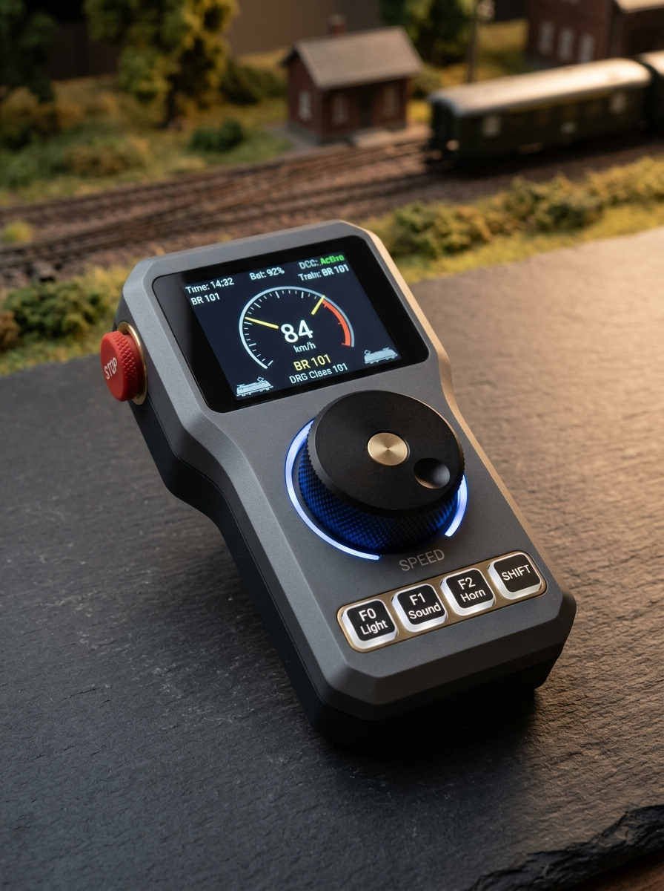

# 🚂 TrainMaster ThrottleOne – Mobiler ESP32 Funk-Handregler
> **Hardware- & Software-Konzept für einen autarken, ergonomischen WLAN-Handregler mit Custom-PCB und 3D-Druck-Gehäuse.**



---

## 🎯 1. Zielsetzung & Vision

Der **TrainMaster ThrottleOne** ist ein eigenständiger, drahtloser Handregler zur physischen Modellbahnsteuerung. Er verbindet die intuitive Einhandbedienung klassischer Fahrpulte (wie Roco WLANmaus oder ESU Mobile Control) mit der modernen Web- und Automatik-Architektur von **TrainMaster**.

### Kernanforderungen:
- 📱 **100 % native TrainMaster-Integration**: Direkte WebSocket-Kommunikation (`ws://<TrainMaster-IP>:3001`) – verzögerungsfrei (< 10 ms Reaktionszeit).
- 🔋 **Akkulaufzeit**: 8–15 Stunden Dauerbetrieb mit Li-Ion/LiPo-Akku und USB-C Ladeport.
- 🎛️ **Haptik**: Hochwertiger Drehimpulsgeber mit fühlbaren Rasten für präzise Geschwindigkeitsregelung und direkt erreichbarer Not-Aus-Taster.
- 📺 **Brillantes Farbdisplay**: 1.54"–2.0" IPS-Display für Lok-Icon, Tachometer, F-Tasten-Zustände, Fahrtrichtung und Block-Name.
- 🖨️ **3D-Druck & Custom-PCB**: Einfach zu Hause druckbar, mit professioneller Platine (z. B. via JLCPCB / PCBWay) und Standard-Bauteilen.

---

## 🏗️ 2. Systemarchitektur

```mermaid
graph TD
    subgraph "TrainMaster ThrottleOne (ESP32)"
        ENC[Dreh-Encoder + Tastklick] --> MCU[ESP32-S3 Dual-Core]
        BTN[Funktionstasten F0-F28 & Nothalt] --> MCU
        TFT[1.54''/2.0'' IPS Display ST7789] <-- SPI --> MCU
        HAP[Vibrationsmotor LRA/ERM] <-- PWM/GPIO --> MCU
        BAT[18650 Li-Ion / LiPo 2000mAh] --> PMIC[TP4056 / IP5306 + 3.3V LDO]
        PMIC --> MCU
    end

    subgraph "WLAN-Netzwerk"
        MCU <-- "WebSocket (JSON / Port 3001)" --> TM_SERVER[TrainMaster Server (Node.js)]
    end

    subgraph "Modellbahnanlage"
        TM_SERVER --> DCC[DCC-EX / Z21 Zentrale]
        TM_SERVER --> WIO[ESP32 WIO Nodes]
    end
```

---

## 🧰 3. Hardware & Stückliste (BOM)

### A. Kernkomponenten & Elektronik
| Komponente | Empfohlenes Bauteil | Zweck / Details | Ca. Preis |
|---|---|---|---|
| **Mikrocontroller** | **ESP32-S3-WROOM-1** (oder Seeed XIAO ESP32-S3) | 240 MHz Dual-Core, 8MB Flash, 2MB PSRAM, Wi-Fi 2.4GHz, natives USB | 4,50 € |
| **Display** | **1.54" IPS TFT (ST7789)** 240x240 SPI *(oder 1.28" GC9A01 Rund-Display)* | Blickwinkelstabil, leuchtstark, flüssige 60 FPS für Tacho & Lokbilder | 4,00 € |
| **Geschwindigkeitsregler** | **Bourns PEC11R** oder **Alps EC11** mit Drucktaster | 24 Impulse/Umdrehung mit Rastung. Klick = Halt / Rangiergang | 1,80 € |
| **Nothalt-Taster** | 12mm Taktiler roter Drucktaster (oben links/rechts) | Sofortige Not-Aus-Abschaltung des Gleisstroms | 0,80 € |
| **Funktionstasten** | 4–6x Silikon- oder Mikrotaster (6x6mm Soft-Touch) | F0 (Licht), F1 (Sound), F2 (Pfeife/Hupe), Lok-Wechsel | 1,50 € |
| **Richtungsumschalter** | 3-Positionen Schiebeschalter oder Wipptaster (Vor - Halt - Zurück) | Fühlbare Richtungswahl ohne Hinsehen | 0,90 € |
| **Haptisches Feedback** | Miniatur-Münzvibrationsmotor (1027, 3V) | Haptische Klicks beim Drehen, Vibration bei Nothalt | 0,60 € |
| **Power Management** | **IP5306** (All-in-One) oder **TP4056 + ME6211 (3.3V LDO)** | USB-C Ladeelektronik, Überladeschutz, Tiefentladeschutz | 1,20 € |
| **Akku** | **18650 Li-Ion (3000 mAh)** oder Flach-LiPo (1800 mAh) | Hält locker 10–14 Stunden Modellbahn-Fahrbetrieb | 4,50 € |
| **Buchsen & Kleinteile** | USB-C 16-Pin Buchse, Ein/Aus-Schiebeschalter, M3 Gewindeeinsätze | Sauberes Gehäuse-Finish | 2,00 € |
| **Gesamtkosten Elektronik** | | | **~ 22–25 €** |

---

## 🎨 4. Display-Konzepte: Rechteckig vs. Runder Tacho

### Variante A: 1.54" IPS Rechteckig (240x240) – *Informations-Fokus*
```text
+------------------------------+
| 🔋 85%   📶 -52dBm   [HP1 🟢]|  <-- Statusleiste
|------------------------------|
| 🚂 BR 101 023-8 DB Regio     |  <-- Aktive Lokomotive
|                              |
|          [ 84 km/h ]         |  <-- Große Digitalanzeige
|     [==================    ] |  <-- Geschwindigkeitsbalken
|          VORWÄRTS (>>)       |
|------------------------------|
| [F0:Licht] [F1:Snd] [F2:Horn]|  <-- F-Tasten-Status
| Block: Bf Gleis 1 (Frei)     |  <-- Live-Block-Information
+------------------------------+
```

### Variante B: 1.28" GC9A01 Rund-Display – *Vintage Tacho-Fokus*
- Kreisförmige Tachoskala von 0 bis 160 km/h mit dynamischer digitaler Nadel.
- In der Mitte: Lok-Baureihe und aktuelle Geschwindigkeit.
- Äußerer Kreisring: Leuchtende Punkte für aktive Sound- und Lichtfunktionen.

---

## 🖐️ 5. Ergonomie & 3D-Druck-Konzept

### Gehäuse-Design (Zweiteilige Schalenkonstruktion):
1. **Oberschale (Top Shell)**:
   - Eingelassenes Displayfenster mit 1.5mm Fase (optional Platz für eine dünne Acrylglas-Schutzscheibe).
   - Aussparung für den griffigen Dreh-Encoder-Knopf (ø 28–32 mm, mit Rändelung und Fingermulde).
   - Ergonomisch geformte Vertiefungen für die F-Tasten, bedienbar mit dem Daumen.
   - Oben abgeschrägte Schultertaste für den **NOTHALT** (mit dem Zeigefinger blind ertastbar).
2. **Unterschale (Bottom Shell)**:
   - Handgerechte Taillierung mit Fingermulden auf der Rückseite für sicheren Halt.
   - Integriertes Fach für eine 18650-Zelle (mit Snap-Fit oder verschraubtem Akkudeckel).
   - Aussparung für die USB-C Ladebuchse an der Unterseite.
   - Öse für ein Umhängeband (Lanyard), um Abstürze auf den Boden zu verhindern.
3. **Fertigungsmethode**:
   - **Material**: PLA+, PETG (sehr schlagzäh) oder mattes Harz (Resin) für feinste Oberflächen.
   - **Befestigung**: M2.5 oder M3 Messing-Einschmelzgewinde (Heat-Set Inserts) – kein Ausleiern bei Wartung.

---

## 💻 6. Software- & Firmware-Architektur

### A. FreeRTOS Task-Aufteilung auf dem ESP32:
- **Core 0 (Network & Communication)**:
  - WebSocket-Client mit Auto-Reconnect und mDNS-Discovery (`trainmaster.local`).
  - Sendet und empfängt native JSON-Nachrichten mit minimalem Ping.
- **Core 1 (UI & Hardware I/O)**:
  - Encoder-Interrupts mit hardware-gestütztem PCNT (Pulse Counter) oder Gray-Code-Entprellung.
  - Tasten-Scanning mit Short-Press / Long-Press Erkennung (z. B. F-Taste kurz = Umschalten, lang = F-Key Info).
  - Display-Rendering via **TFT_eSPI** oder **LVGL** (flimmerfrei dank Double-Buffering im PSRAM).

### B. Nativer TrainMaster WebSocket-Datenaustausch:

#### 1. Beim Einschalten (Handshake & Lok-Liste anfordern):
```json
// ESP32 empfängt initialen Status & Loks vom Server:
// Typ 'INITIAL_STATE' enthält automatisch alle Loks mit Namen, Adressen & Bild
```

#### 2. Geschwindigkeit & Fahrtrichtung senden:
```json
{
  "type": "SET_LOCO_SPEED",
  "payload": {
    "locoId": "loco-ice-3",
    "speed": 72,
    "direction": "FWD"
  }
}
```

#### 3. Funktionstaste (z. B. Pfiff F2):
```json
{
  "type": "SET_LOCO_FUNCTION",
  "payload": {
    "locoId": "loco-ice-3",
    "functionIndex": 2,
    "active": true
  }
}
```

#### 4. Nothalt auslösen:
```json
{
  "type": "EMERGENCY_STOP"
}
```

---

## 🚀 7. Geplante Phasen zur Umsetzung

1. **Phase 1 – Steckbrett-Prototyp (Breadboard)**:
   - ESP32-DevKit + ST7789 Display + Drehencoder + 2 Buttons auf einem Breadboard.
   - Firmware mit Basis-WebSocket-Anbindung und Lok-Geschwindigkeitsregelung.
2. **Phase 2 – Custom-PCB Layout (EasyEDA / KiCad)**:
   - Einteilige Platine, auf der ESP32, Display-Header, Taster, Encoder und Li-Ion-Lader direkt verlötet sind.
3. **Phase 3 – 3D-Gehäusedesign (Fusion 360 / STEP)**:
   - Perfekt angepasstes Gehäuse für Einhandbedienung inklusive Akku-Halterung.
4. **Phase 4 – Erweiterte Features**:
   - Weichen- und Fahrstraßen-Schaltung direkt vom Handregler.
   - Haptisches Feedback (Klicks beim Drehen, Rütteln bei Halt).
